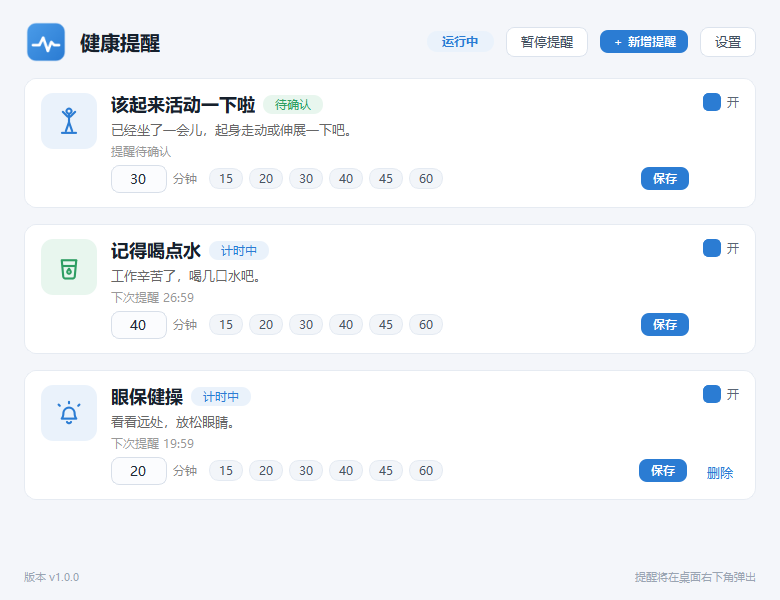
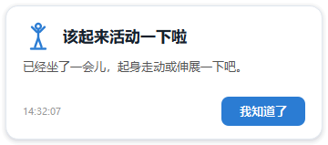

<div align="center">

# QingXing · 轻醒

### A gentle nudge to care for yourself during the workday.

**Windows 10/11**　·　**Runs locally**　·　**No account required**

[简体中文](README.md)　|　English

<br>



<br>



</div>

## About

QingXing is a lightweight Windows desktop health reminder. It helps you take a break, stand up, and drink water during long work sessions. You can also create reminders that fit your routine. All reminders and settings stay on your computer.

## Features

| Reminder | How it works |
| --- | --- |
| Move around | Starts at 30 minutes; can be enabled, disabled, or adjusted independently. |
| Drink water | Starts at 40 minutes; can be enabled, disabled, or adjusted independently. |
| Custom reminders | Set a title, message, and interval from 1 to 720 minutes; delete them any time. |
| Pause and resume | Pausing freezes the remaining time; resuming continues the countdown. |
| Due reminder queue | Reminders that become due together appear one at a time in order. |
| System tray | Open the window, test reminders, pause, or quit from the tray menu. |

When a reminder is due, a topmost popup appears. Click **Got it** to dismiss it and schedule the next reminder. The main window can minimize to the system tray so reminders continue in the background.

## Quick start

### Run from source

Requires Windows 10/11 and Python:

```powershell
python -m pip install -r requirements.txt
python app.py
```

### Build a standalone executable

```powershell
python -m pip install -r requirements-dev.txt
scripts\build_windows.bat
```

The executable is created at `dist\DesktopHealthReminder.exe`. It is built with PySide6 Deploy and Nuitka, runs without a console window, and includes the Qt runtime and UI assets.

## Development and tests

```powershell
python -m pip install -r requirements-dev.txt
python -m pytest
```

Tests use Qt's offscreen mode and do not open real windows. Main code areas:

| Path | Responsibility |
| --- | --- |
| `app.py` | Application entry point and component wiring. |
| `src/scheduler.py` | Countdowns, pause/resume, due queue, and rescheduling. |
| `src/storage.py` | Atomic config saves, corrupt-file backup, and recovery. |
| `src/reminder_manager.py` | Reminder queue, popup display, and acknowledgment flow. |
| `src/tray_manager.py` | System tray and menu. |
| `src/ui/` | Main window, reminder cards, popup, and styles. |
| `tests/` | Scheduler, storage, tray, popup, and UI tests. |

## Local data and privacy

QingXing does not use the network, accounts, or telemetry. Configuration and logs stay in the current Windows user profile:

| Data | Path |
| --- | --- |
| Settings and reminders | `%APPDATA%\DesktopHealthReminder\config.json` |
| Corrupt config backup | `%APPDATA%\DesktopHealthReminder\config.corrupt-*.json` |
| Application log | `%APPDATA%\DesktopHealthReminder\logs\app.log` |

Delete `%APPDATA%\DesktopHealthReminder` to clear local settings and logs. If Windows startup is enabled, the app only writes its own entry to the current user's `Run` registry key.

## Debug options

| Argument | Description |
| --- | --- |
| `--config <path>` | Use a specific JSON config file; defaults to the `%APPDATA%` path above. |
| `--shift-minutes N` | Shift all next reminders by N minutes for demonstrations. |
| `--exit-after <seconds>` | Exit after the specified time for launch checks and automation. |
